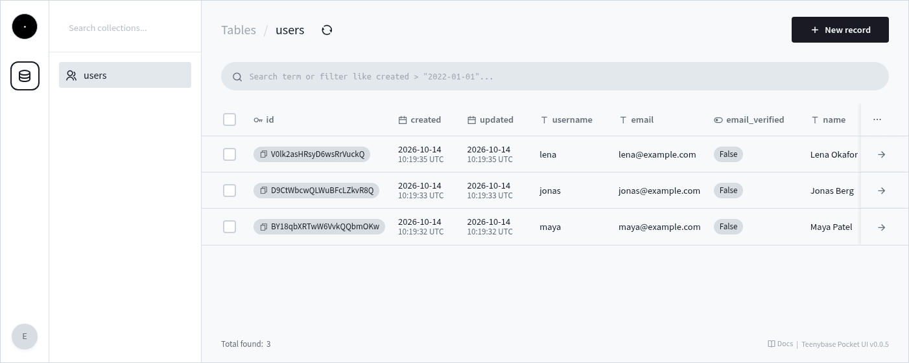

<div align="center">

  <h1>Pocket UI</h1>

  <p><strong>The admin panel for <a href="https://github.com/teenybase/teenybase">teenybase</a>.</strong></p>

  <p>
    <a href="https://www.npmjs.com/package/@teenybase/pocket-ui"></a>
    <a href="LICENSE"></a>
  </p>

  <p>
    <a href="https://teenybase.com">Website</a> &nbsp;&bull;&nbsp;
    <a href="https://github.com/teenybase/teenybase">teenybase</a> &nbsp;&bull;&nbsp;
    <a href="https://teenybase.com/docs/">Docs</a>
  </p>

</div>

Browse and edit your tables, users and files in the browser. Every teenybase app serves it at `/api/v1/pocket/`. It's a fork of the [PocketBase](https://github.com/pocketbase/pocketbase) admin dashboard, adapted to teenybase's API.

<p align="center"></p>

> teenybase is early (v0.1): APIs may change before 1.0.

## Try it

You don't install this package yourself: teenybase loads an exact, pinned version of it from jsDelivr.

```bash
npx teenybase create my-app --yes
cd my-app
npx teenybase deploy --local --yes
npx teenybase dev
```

Open http://localhost:8787/api/v1/pocket/ and log in as `viewer` (read-only) or `editor` with the passwords in `.dev.vars` (`POCKET_UI_VIEWER_PASSWORD`, `POCKET_UI_EDITOR_PASSWORD`), or with `ADMIN_SERVICE_TOKEN` as any role (`viewer`, `editor`, `superadmin`).

## How teenybase uses it

```ts
import { PocketUIExtension } from 'teenybase/worker'

// serves /api/v1/pocket/ from https://cdn.jsdelivr.net/npm/@teenybase/pocket-ui@<pinned version>/dist/
db.extensions.push(new PocketUIExtension(db))
```

The new projects `npx teenybase create` makes already include it. Options (`baseUrl`, `uiVersion`) are in the [config reference](https://teenybase.com/docs/reference/config-reference).

## Development

```bash
npm install          # also builds dist/ (the prepare script)
npm run dev          # Vite dev server on http://localhost:3000, talking to `npx teenybase dev` on :8787
npm run build        # production build into dist/
```

Build settings (API URL, docs and releases links, version) are in [`ui.config.ts`](ui.config.ts); override one for a local build with an environment variable of the same name, e.g. `PB_BACKEND_URL=http://localhost:8790/api/v1 npm run dev`. To try a local build inside an app, run `npm run build && npx vite preview --port 4173` and pass `baseUrl: 'http://localhost:4173/'` to `PocketUIExtension`.

## Releases

Bump `version` in `package.json`, add its section to [CHANGELOG.md](CHANGELOG.md) and push to `master`. The [publish workflow](.github/workflows/publish.yml) builds and packs the package and, after a maintainer approves, publishes it to npm with provenance through [release-tools](https://github.com/repalash/release-tools). teenybase then moves its pin (`POCKET_UI_VERSION` in `src/worker/util/pocketui.ts`).

## Credits and license

MIT, like PocketBase: see [LICENSE](LICENSE). This UI is a fork of the [PocketBase](https://github.com/pocketbase/pocketbase) admin dashboard (`ui/`), and `src/client` is a modified subset of the [PocketBase JS SDK](https://github.com/pocketbase/js-sdk), both © Gani Georgiev under MIT; the notice is kept in [LICENSE](LICENSE) and [NOTICE](NOTICE).
